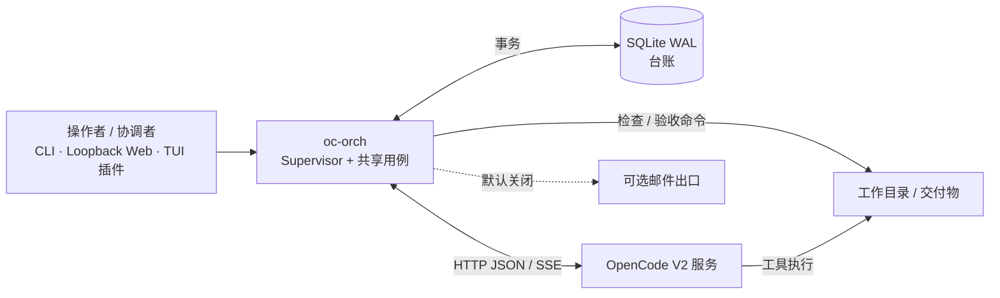

# oc-orch

**面向 OpenCode 的多 Session 可靠调度、恢复与交付验收 Supervisor。**

oc-orch 是一套独立的本地 Supervisor 与 SQLite 台账。它把「协调者 session → 多个执行 session」的协作从聊天上下文里拿出来，记录成可恢复、可对账、可验收的状态机：任务目标、执行尝试、回合、受管输入、后续责任、通知、告警、写权与验收证据。

它不修改 OpenCode 本体，只使用官方 V2 HTTP API 与 SSE 观察和驱动 session。协调者本身通常是一个长期运行的 OpenCode session；oc-orch 不改绑它的模型或上下文，只把可行动的事实送到它的 inbox，并把显式承诺记录成责任与验收事实。

> **核心判断：事件只是触发器，REST 状态才是事实；回合成功只是回合结束，任务通过必须有独立验收证据。**

**快速导航：** [设计原则](#2-设计原则) · [架构](#3-架构) · [可靠性语义](#6-可靠性语义) · [快速开始](#8-快速开始) · [安全与边界](#12-安全与边界) · [当前状态](#13-当前状态与未承诺范围)

---

## 1. 它解决什么问题

多 Agent 协作的失败往往不是“模型不会做”，而是**状态没有被可靠地记住**：

| 真实问题 | oc-orch 的机制 |
|---|---|
| 执行 session 漏回报，协调者以为还在跑 | SSE 终态观察 + 周期 REST 对账；不依赖 worker 聊天回执 |
| SSE 断流、Supervisor 崩溃、机器重启 | SQLite 持久台账；启动恢复 inflight；断流后强制一次全量对账 |
| 重复派单、重复唤醒、消息堆栈 | session/message ID 由客户端预生成，服务端幂等；通知按去重键合并；目标已有 pending inbox 时抑制新唤醒 |
| 主协调空闲不推进，busy 又被打断 | 空闲时投递唤醒；busy 时排队；同一目标最多一个持久未决唤醒 |
| 权限/表单等待被误判为卡死 | 真实 `permission.asked` / `form.created` + REST 复查；只通知，绝不自动批准 |
| 长工具执行被误判为停滞 | 记录 active tool，按工具宽限期观察，不把“安静”当“完成” |
| 429、403、额度或模型不可用 | 分类为限流、认证/额度阻塞、模型不可用；有界退避与冷却，不无限重试 |
| 旧 worker 未停就换人 | 写现场按路径前缀排他；停止请求 ≠ 实际停止；未确认不释放写权 |
| 旧结果、旧事件晚到 | 尝试代次与 `current_attempt_id` 守卫；首终态优先；旧尝试不能推进当前任务 |
| 派单结果未知 | 保留原 session/message ID 对账，绝不换 ID 重投 |
| 依赖满足后没人继续 | 结构化责任台账：谁在等什么、下一动作、期限与接续目标 |
| 聊天说“完成了”但没有证据 | 显式 collect + 交付物门禁 + verify；`execution.succeeded` 不能直接产生 `accepted` |
| 策略切换把在途工作搞乱 | 版本化策略、不可变历史、非抢占切换；只影响后续许可，不重播 unknown |

---

## 2. 设计原则

1. **事件是触发器，REST 是事实。** SSE 只负责尽快触发一次对账；断流、丢事件、重连后的完整事实由 REST 补齐。SSE 不假设可重放。
2. **执行成功 ≠ 任务验收。** `session.execution.succeeded` 只表示回合结束。任务正常进入 `accepted` 必须经过结果收集、交付物检查、来源校验和显式 `verify --pass`；`--force` 是带原因的例外，并会保存未满足项。
3. **原身份不可替换。** session、message、input 都有持久 ID。派单/投递结果未知时，先查原 inbox/message，再决定是否用同一 ID 重试；不制造第二个身份。
4. **未知不重投，未知不猜。** 网络超时、非 JSON 响应、5xx、断线都可能意味着“请求已执行但响应丢失”。这类结果必须保持 unknown，只做有界对账。
5. **停止请求 ≠ 已停止。** 停止只写 `stop_requested`；确认实际停止后才释放写现场。文件/外部副作用无法撤销，这是台账必须保守的原因。
6. **单实例、CAS 与首终态。** Supervisor 用 `flock` 保证单实例；CLI/Web/Supervisor 共享同一套应用用例与 SQLite 事务；协调者租约按 epoch 接管；状态推进用期望版本/CAS；首个终态优先，晚到的失败不能改写成功。
7. **有界重试、去重与抑制。** 通知有 `dedupe_key`、有限重试、ack 超时和死信告警；同一目标同时只保留一个未消费唤醒，避免把消息栈压满。
8. **人工闸门 fail-closed。** 权限、表单、写权释放、强制验收都需要明确的人工动作。缺字段、坏形状、未知状态一律拒绝，不静默降级为“成功”。
9. **策略是投影，授权是授权。** 工作模式只是提示词投影，不改变模型、工具、费用或验收标准；真正的资源允许来自独立、可撤销、带有效期的资源授权。
10. **状态必须可解释。** `pending`、`unknown`、`blocked`、`stalled` 都是一等状态，不伪装成成功。每个状态变化都有审计记录。

### 关键取舍

| 选择 | 得到什么 | 放弃什么 |
|---|---|---|
| 外部 Supervisor，而不是修改 OpenCode | OpenCode 可独立升级；边界清晰 | 只能依赖公开 V2 API，不能透明拦截所有内部调用 |
| SQLite 台账，而不是消息队列/外部数据库 | 单文件、事务、可检查、零运维 | 单机；跨主机需要另行设计 |
| SSE 触发 + REST 对账，而不是只信事件 | 断流、丢事件、重启后可恢复 | 每次重连都要付一次全量对账成本 |
| 回合成功与任务验收分离 | 防止“聊天说完成”变成假完成 | 验收需要显式 collect/verify |
| 版本化、非抢占的策略切换 | 在途工作安全，历史可审计 | 切换不是立即全局生效 |
| 提示词投影与资源授权分离 | 不虚假承诺模型/费用强制 | 需要独立授权与入口覆盖 |

---

## 3. 架构



oc-orch 自身按五层组织，依赖方向由 AST 边界检查守卫：

| 层 | 职责 | 关键约束 |
|---|---|---|
| `domain/` | 状态、分类、验收、唤醒、策略、授权等纯规则 | 不读库、不发网络、不碰子进程 |
| `application/` | CLI/Web/Supervisor 共享用例与事务外编排 | 通过窄端口依赖台账、时钟、执行器 |
| `adapters/` | SQLite、HTTP/SSE、文件证据、检查命令、邮件 | 唯一业务写入路径是台账 |
| `runtime/` | Supervisor 调谐、SSE 生命周期、周期对账 | 单实例；事件只触发，不承担事实 |
| `entrypoints/` | CLI、loopback Web、随包 Web 资产 | 每请求独立连接；共享应用用例 |

`composition.py` 是默认装配点：SQLite、OpenCode Client、文件证据、时钟和可选能力在这里按需惰性装配。没有运行时第三方 Python 依赖。

---

## 4. 核心对象

| 对象 | 含义 | 关键不变量 |
|---|---|---|
| **Task** | 业务目标 | `accepted/cancelled` 为终态；`paused` 保留在途工作；验收只由显式 verify 写入 |
| **Attempt** | 一次执行尝试，可跨多个回合 | `(task_id, generation)` 唯一；只有 `current_attempt_id` 能推进任务；终态后只能按白名单推进 |
| **Turn** | 一次 `execution.started → execution.ended` | 与 attempt 分开记录；回合结束不等于尝试验收 |
| **Deliverable** | 声明的产物/检查命令 | 验收时核对存在性、来源、内容指纹与检查证据绑定 |
| **SessionInput** | 一条受管输入（自动唤醒或显式发送） | 同一目标最多一个持久未决槽位；原 ID 对账；unknown 不重投 |
| **Responsibility** | 未完成工作的后续责任 | 等待条件、责任人、下一动作、期限与接续目标；ACK 或回合结束不能静默丢责任 |
| **Notification / Alert** | 协调唤醒与人工告警 | `dedupe_key` 合并；有限重试；未确认转 dead + 告警 |
| **Lease / Policy** | 协调者租约与版本化交付策略 | epoch/CAS 防旧持有者；策略不可变、非抢占、可审计 |

**Task**：`draft → dispatched → running → result_pending → result_received → accepted`；异常为 `blocked/stalled/rejected/cancelled`，`rejected` 可经 rework 回到 `running`。

**Attempt**：`creating → dispatched/dispatch_unknown → running → terminal_succeeded/failed/interrupted → result_collected/result_missing → accepted/rejected`；首个终态优先，旧尝试不能写当前任务。

SQLite 当前为 schema 3，WAL 模式。`1→2→3` 是显式迁移；整个迁移在 `BEGIN IMMEDIATE` 中完成，失败整体回滚。不猜测历史事实，不自动重放旧输入。

---

## 5. 一次交付如何闭环

```text
登记 Task
  → dispatch 预生成 session/message ID，先记派单意图
  → SSE + REST 观察回合、工具、权限、表单、provider 重试
  → 终态兜底：收集 assistant 结果与交付物
  → 显式 verify：当前尝试 + 交付物门禁 + 来源/指纹 + 检查证据
  → accepted / rejected → rework 或责任转交
  → 协调者通过 inbox 收到可核对的通知并 ACK
```

几个容易被忽略、但设计上刻意分开的点：

- **dispatch 是两阶段的**：先把“准备用哪个 ID 发什么”写入台账，再发网络请求。响应丢失时仍是同一个尝试，不会变成两个。
- **collect 不产生 accepted**：它只把结果、交付物与来源事实落库。验收结论只能由 `submit_verification` 写。
- **verify 是事务外准备 + 单事务提交**：检查命令、结果文件读取、证据快照在事务外完成；提交时重新核对 guard 指纹，防止中间被并发改写。
- **force 不是万能钥匙**：`--force --pass` 必须给出原因并保存未满足项；它不能把仍在执行、未终态的尝试变成可验收。
- **通知送达不是业务完成**：`sent` 只表示 HTTP 已受理；协调者 ACK 和任务 verify 是不同事实。

---

## 6. 可靠性语义

| 场景 | 行为 |
|---|---|
| SSE 断流/重连 | 重连后重新读取服务发现，强制执行一次 cycle；不假设事件可重放 |
| 回合终态丢失 | REST 读 `Session.Info.outcome` 兜底；首个终态优先 |
| 派单超时/结果未知 | 原 ID 查 session/inbox/messages；只在“未受理”时同 ID 重试 |
| 通知响应丢失 | 通过 `session.inbox.enqueued` / 原 message ID 对账，不新造消息 |
| 目标 busy / inbox 非空 | 新通知保持 pending 并延期；不打断当前回合、不压栈 |
| 目标长时间未 ack | 有限 nudge；用尽转 dead + 告警 |
| provider 429/5xx | 记录 provider 退避；派单在退避期内拒绝扩 session（除非显式忽略） |
| provider 403/额度/模型不可用 | 长冷却 + 单次探测；新错误重新冷却，不静默绕过 |
| 权限/表单等待 | `blocked_*` + 通知；人工回复；从不自动批准 |
| 长工具执行 | active tool + 宽限期；超宽限才告警 |
| 人工中断 | `interrupted`，不自动复活；恢复需显式动作 |
| 项目暂停 / 回合 hold / provider 阻塞 | 三种控制独立保存；解除其一不会误清另外两个 |
| 旧结果晚到 | 非 current 尝试返回 `NOT_CURRENT`；旧事件标记 stale，不推进当前 |
| Supervisor 重启 | 回收 inflight；保留原输入/消息身份；从台账继续对账 |

---

## 7. 主要能力

### 7.1 任务与执行

- 登记目标、验收标准、写范围、交付物和检查命令。
- 创建或附着执行 session；支持 agent、model、variant、目录、期限与停滞阈值。
- 同一 session 上 rework 保留上下文；新尝试使用新的代次和消息。
- 任务级 pause/resume/cancel；Web 取消需要输入任务 ID 显式确认。
- 写现场按路径前缀排他；旧尝试未释放时拒绝新的重叠派单。

### 7.2 通知、唤醒与告警

- 通知按目标聚合，一个回合可以处理多条通知。
- 通知是 at-least-once：同一事实合并去重，但不宣称物理零重复；重复唤醒不会重复业务执行，因为任务/尝试状态机才是唯一事实。
- 同一事实只保留一个未消费通知；已 sent/inflight 的合并不会重置 ack 期限。
- 空闲目标才唤醒；busy 目标排队；inbox 非空时抑制。
- 通知未确认、权限阻塞、协调者失败、provider 异常等形成独立告警。
- 告警可 ACK；死信保留，不静默丢弃。
- 晚到的投递结果不覆盖已经发生的 ACK；ACK 不会倒退。

### 7.3 受管输入与责任连续性

- `send` 默认登记托管责任；`input` 提供发送意图、回执、对账、ACK、flush、cancel 和 resume-target。
- 输入有持久 ID、原消息 ID、正文哈希、批次成员、admission 状态和有界重试预算。
- `flush` 只对唯一自有目标做原 ID steer；`cancel` 不隐式 ACK；unknown 只对账原身份。
- 责任台账记录“谁在等待什么、下一动作是什么、何时到期”；依赖满足生成去重复核待办。
- ACK、回合结束、通知送达都不会自动关闭未完成责任。
- 显式 conversation 补充输入先持久化原意图，再按原 ID/完整窗口观察结束；不自动接管、不解除项目暂停、不把请求字段当可信来源。

### 7.4 交付策略与资源授权

交付策略追求的不是“更快地聊天”，而是四条共同底线：**快**（缩短可信交付的关键路径）、**准**（以需求、事实和必要验证裁决）、**狠**（集中攻坚、停止无效循环）、**优**（简单、稳定、可维护）。资源偏好是另一个维度，不等于降低验收标准。

- 版本化策略：`latency-first`、`budget-first`、`elastic`；阶段：`standard`、`prototype`。
- 工程上限：`max_parallel`、`max_candidates`、`max_challenge_rounds`，都是有限保护范围，不是必须用满。
- 项目默认与任务快照分离；任务切换/继承生成新版本；历史版本不删除。
- 非抢占：切换只影响后续许可，不取消在途、不重播 unknown、不倒退台账。
- 独立资源授权：按 project/task/coordinator 记录明确的 `provider/model`、费用属性、证据、有效期与撤销。
- 单次动作许可在发送前与策略/授权/写权/控制状态一起线性化；过期、撤销、unknown 均不续旧许可。
- 工作模式是提示词投影，不改变模型/provider/工具权限，也不锁定费用。

### 7.5 Web 控制面

- 仅 loopback：`127.0.0.1`、`localhost`、`::1`。
- 写请求要求 JSON、`X-OC-Orch-Web: 1` 并校验 Origin；业务动作与 CLI 共用应用服务。
- 以协调者工作台为中心：总览按 running/blocked/result_pending 等状态分组，任务页聚合尝试、回合、责任与验收，诊断页展示 Supervisor、服务、SSE 与告警。
- 可查看总览、协调者、任务、尝试、诊断、表单、策略与原型范围。
- 支持 ACK、暂停/继续/取消、collect、verify、Supervisor 启停；危险动作需要明确确认。
- `--read-only` 提供只读模式。

### 7.6 OpenCode TUI 插件

`integrations/oc-orch-bridge/` 提供一个零运行时依赖的薄客户端候选，位于非自动发现目录：

- 命令：`oc-orch.delivery-policy.{status,switch-task,switch-project,replay,sync-instructions}`、`oc-orch.project.{pause,resume,reconcile}`、`oc-orch.conversation.{send,observe}`。
- 默认禁写；写操作需要显式配置、能力表、发布身份/租约/CAS 与逐字确认。
- 项目控制与显式对话意图先存入宿主 durable storage，再 POST 一次；重启后只在显式 reconcile 中读取原回执，不重发。
- 指令条目是非权威投影，不证明模型已消费；共用协调者的模型不会因 Task 策略被改绑。
- GUI 入口只有源码候选，默认不导出、写入关闭。

### 7.7 原型与度量

- `prototype` 记录原型目标、代表路径、mock/占位/受阻缺口、责任与修复证据；缺口有稳定身份，不篡改正式任务承诺。
- `delivery-metrics` 只对固定 cohort/窗口做纯文件计算，不连接服务、不写台账；未结/失败样本保留，零分母输出 `null`。

### 7.8 邮件提醒（可选）

- 默认关闭；需要独立的 `email-policy.json` 与显式授权。
- 发送走持久 outbox：先认领、再发送；结果未知先补证，不盲目重发。
- 只做“需要人工介入”的通知出口，不解析邮件回复来执行控制。

### 7.9 Provider 故障恢复

- 默认不自动恢复。用 `oc-orch failover status` 查看本地故障链，再核对独立资源授权、路线和恢复写契约。
- `oc-orch failover contract status` 只读检查契约；`contract install --confirm 'INSTALL provider-failover-v1'` 仅在停写并完成一致备份后安装。安装契约不会启用项目策略，也不会授予模型/费用权限。
- `failover policy show --project <项目>` 或 `--task <任务>` 查看策略；`set-project` / `set-task` 要求完整策略 JSON、期望版本、operation ID、原因和与目标完全相同的确认文本。资源授权仍须独立配置。
- `failover tick --episode <ID> --confirm 'RUN <ID>'` 可能切换同一 session 的模型并发送后继输入。`release` 和 `route-clear` 也都要求精确确认与原因。
- 遇到 possible/unknown 操作时保留原身份并先对账。回退时先停止新的自动动作并核对未决操作；不得删除 failover/continuity 写保护或用旧备份覆盖新增事实，旧版写入者不能在新契约下运行。
- 开发 fake-Service 核收不表示真实模型、真实邮件或生产发布已经核验；这些状态分开记录。

### 7.9 Provider 故障恢复

- 默认不自动恢复。先用 `oc-orch failover status` 查看本地故障链，再核对独立资源授权、路线和恢复写契约。
- `oc-orch failover contract status` 只读检查契约；`contract install --confirm 'INSTALL provider-failover-v1'` 仅在停写并完成一致备份后安装。安装契约不会启用项目策略，也不会授予模型/费用权限。
- `failover policy show --project <项目>` 或 `--task <任务>` 查看策略；`set-project` / `set-task` 需要完整策略 JSON、期望版本、operation ID、原因和与目标完全相同的确认文本。资源授权仍须独立配置。
- `failover tick --episode <ID> --confirm 'RUN <ID>'` 可能切换同一 session 的模型并发送后继输入。`release` 和 `route-clear` 也都要求精确确认与原因。
- 遇到 possible/unknown 操作时保留原身份并先对账。回退时先停止新的自动动作并核对未决操作；不得删除 failover/continuity 写保护或用旧备份覆盖新增事实，旧版写入者不能在新契约下运行。
- 开发 fake-Service 验收不表示真实模型、真实邮件或生产发布已经核验；这些状态分开记录。

---

## 8. 快速开始

### 环境要求

- Python 3.10+（运行时只用标准库）。
- Linux/POSIX 环境（Supervisor 使用 `flock`；systemd 模板面向 Linux，其他平台未验证）。
- 本机已有 OpenCode V2 服务。
- 服务发现默认读取 `~/.config/opencode/service.json`；可用 `OC_ORCH_SERVICE_CONFIG` 指向其他文件。
- 契约基线为 OpenCode 2.2.5；升级 OpenCode 后先运行 `oc-orch doctor` 核对 API。

### 从源码运行

```sh
git clone https://github.com/vicat47/oc-orch.git
cd oc-orch

./bin/oc-orch init
./bin/oc-orch doctor
./bin/oc-orch supervisor start
./bin/oc-orch status
```

状态目录默认是 `~/.local/share/opencode-orchestrator`（若设置了 `$XDG_DATA_HOME`，则为 `$XDG_DATA_HOME/opencode-orchestrator`），可用 `--home` 或 `OC_ORCH_HOME` 覆盖。

Supervisor 是常驻调谐器；不启动它时，CLI/Web 仍可手动执行 `reconcile`、`collect`、`verify` 等动作，只是没有自动观察、通知与唤醒。

### 安装到 PATH

```sh
# 方式一：仓库脚本（符号链接 + init + 启动 Supervisor）
sh deploy/install-user-service.sh

# 可选：安装 systemd user service
sh deploy/install-user-service.sh --with-systemd

# 方式二：安装为 Python 包
python3 -m venv .venv
.venv/bin/python -m pip install .
.venv/bin/oc-orch --help
```

### 启动 Web 控制面

```sh
oc-orch web --daemon --port 8787
# 打开 http://127.0.0.1:8787/

oc-orch web --stop
# 只读模式：oc-orch web --read-only
```

Web 当前**没有 token**，只允许 loopback。不要绑定到外部地址，也不要通过反向代理暴露给不可信网络。

---

## 9. 最小闭环

```sh
# 1) 登记任务：目标、验收标准、写范围、交付物、检查命令
oc-orch task create --project demo --title "实现 X" \
  --objective "完成可验证的 X" \
  --acceptance "测试通过" \
  --coordinator ses_xxx \
  --scope /path/to/worktree \
  --deliverable /path/to/worktree/out.txt \
  --check "pytest -q"

# 2) 创建执行 session 并派单（真实 API，自动注入台账标识）
oc-orch dispatch --task T-xxxx --new-session \
  --directory /path/to/worktree --agent build \
  --model provider/model --prompt-file task.md \
  --deadline 3600 --stall-after 900 \
  --work-mode latency-first

# 3) 观察（Supervisor 持续运行；也可单次对账）
oc-orch status
oc-orch reconcile --dispatch

# 4) 协调者收到唤醒后
oc-orch inbox --session ses_xxx --ack-all
oc-orch collect --attempt A-xxxx
oc-orch verify --attempt A-xxxx --pass \
  --evidence "pytest: 12 passed" --run-checks

# 5) 失败与返工
oc-orch verify --attempt A-xxxx --fail --reason "缺少 out.txt"
oc-orch rework --task T-xxxx --feedback-file feedback.md
```

`--dry-run` 可以在不触网的情况下查看派单 prompt；全局 `--json`（放在子命令前，如 `oc-orch --json status`）输出结构化结果，便于脚本消费。

---

## 10. CLI 地图

| 命令组 | 用途 |
|---|---|
| `init` / `service` / `doctor` | 初始化台账、查看服务发现、自检 |
| `task` | 创建、列表、详情、暂停、继续、取消 |
| `dispatch` / `rework` | 创建或附着 session；同 session 新尝试 |
| `attempt` | 尝试列表、详情、停止请求、写现场释放 |
| `collect` / `verify` | 收集结果与交付物；显式验收 |
| `status` / `health` / `reconcile` | 运行摘要、本地业务健康、单次对账 |
| `inbox` / `notify` / `alerts` | 协调者通知、重试、告警 |
| `coordinator` | 租约、接管、暂停/继续、回合 hold、解锁 |
| `send` / `input` / `conversation` | 托管输入、受管输入生命周期、显式对话补充 |
| `responsibility` | 未完成责任的登记、转交、等待、恢复、关闭 |
| `delivery-policy` / `resource-authorization` | 版本化策略与独立资源授权 |
| `failover` | provider 故障链只读状态、显式策略/契约、逐步恢复及人工解除 |
| `failover` | provider 故障链只读状态、显式策略/契约、逐步恢复及人工解除 |
| `prototype` / `delivery-metrics` | 原型范围与缺口；固定 cohort 的纯文件度量 |
| `incidents` / `email` | 人工待办；默认关闭的邮件通知 |
| `permission` | 人工处理权限等待（绝不自动批准） |
| `export` | 导出完整台账 JSON |
| `supervisor` | 前台运行、后台启动、停止、状态 |
| `web` | loopback Web 控制面 |

---

## 11. 开发与测试

默认离线回归完全隔离真实 OpenCode 服务与台账：

```sh
# 全部离线测试（默认 all，自动发现 tests/test_*.py）
python3 scripts/check_offline.py

# 分层运行
python3 scripts/check_offline.py --layer unit
python3 scripts/check_offline.py --layer integration
python3 scripts/check_offline.py --layer contract

# 分层依赖方向 / 架构边界
python3 scripts/check_boundaries.py
```

使用 pytest 和锁定开发依赖：

```sh
uv venv .venv
uv pip install --python .venv/bin/python --require-hashes -r requirements-dev.lock
uv pip install --python .venv/bin/python --no-deps -e .
.venv/bin/python scripts/check_offline.py --layer all --runner pytest
```

Web 前端（Lit + esbuild；生成资源随包分发，运行期不需要 Node）：

```sh
cd web
npm ci --ignore-scripts
npm run build:check   # 逐字节验证生成物与源码一致
npm test              # jsdom 真实 DOM + 打包产物
```

TUI 插件：

```sh
cd integrations/oc-orch-bridge
node --test
```

真实接线验收需要显式选择，会创建并清理真实 session：

```sh
python3 tests/e2e_real.py --all
# 或只跑指定场景
python3 tests/e2e_real.py --only s1,s2
```

离线回归通过不等于真实服务、真实模型或生产验收通过，不能把离线结果当作真实链路证据。开发约定是：一次切片一个目的；保留原失败与反例；离线、真实、生产证据分开；Git 交付不等于上线。

---

## 12. 安全与边界

- **只面向本机既有服务。** 认证来自既有 `service.json`，密码只在进程内存中构造 Basic 头；不打印、不落盘、不用于任意远程主机。
- **Web 仅 loopback。** 当前无 token；依靠同源 Origin、CSRF 头和只读模式收敛风险。不要暴露到公网。
- **内容类事件不落台账。** `session.text.*`、`reasoning.*`、`tool.input.*` 等即使误订阅也会丢弃；显式受管输入只保存冻结正文/哈希，结果文件按需保存 assistant 输出，二者都可能含敏感内容。
- **权限/表单不自动处理。** `permission reply` 只由人工 CLI/Web 显式触发。
- **结果文件可能敏感。** 默认存放在台账目录的 `results/`（0600）；台账目录 0700；导出文件 0600。
- **不能撤销已发生的外部副作用。** oc-orch 只能阻止新的写权授予；共享 worktree 必须配合独立目录/worktree 或人工确认停止。
- **台账只支持向前迁移。** 不要删除写契约触发器、不要混跑旧 schema 写入者、不要直接倒回旧备份。
- **不承诺费用封顶。** 公开 V2 API 没有把单条 prompt 与模型内部调用原子绑定的字段；资源授权只覆盖 oc-orch 自己的受管入口。
- **SSE 是 live-only。** 断流期间的事实靠 REST 对账补齐，不假设事件可重放。

---

## 13. 当前状态与未承诺范围

| 范围 | 状态 |
|---|---|
| 任务/尝试/回合/对账/通知/验收核心 | 已实现；默认离线回归覆盖，真实 E2E 入口另行显式运行 |
| Supervisor 单实例、崩溃恢复、写现场、租约 | 已实现 |
| 受管输入、责任连续性、项目暂停/回合 hold/provider 冷却 | 已实现（按实际入口与契约范围） |
| 版本化交付策略、资源授权、单次许可 | 已实现；运行时强制执行需要显式安装独立写契约 |
| Web 控制面 | 已实现；Lit 源码 + 随包构建产物 + jsdom/Chromium 假 API 验证 |
| OpenCode TUI 插件 | 薄客户端候选；离线测试通过；未自动发现、默认禁写；真实宿主加载需按你的环境验证 |
| 原生 GUI / 桌面插件 | 仅源码候选，默认不导出、写入关闭 |
| 普通原生聊天透明接续 | 未覆盖；不拦截、不自动登记、不宣称可信来源 |
| 跨模型提速 / 费用收益 | 不承诺；需要固定 cohort、同路线对照和账单口径，离线测试不能替代 |
| 多用户、远程主机、公网服务 | 不支持 |

oc-orch 不是 OpenCode 官方组件。它依赖 OpenCode V2 API；不同版本的行为差异请先用 `oc-orch doctor` 和真实 E2E 核对。

---

## 14. 目录

| 路径 | 说明 |
|---|---|
| `bin/oc-orch` | 从仓库源码直接运行的 CLI 入口 |
| `src/oc_orch/domain/` | 状态、分类、验收、唤醒、策略、授权等纯规则 |
| `src/oc_orch/application/` | 共享用例、事务外验收编排、端口定义 |
| `src/oc_orch/adapters/` | SQLite、HTTP/SSE、文件证据、检查命令、邮件 |
| `src/oc_orch/runtime/` | Supervisor 调谐与 SSE 生命周期 |
| `src/oc_orch/entrypoints/` | CLI、loopback Web、随包 Web 资产 |
| `src/oc_orch/composition.py` | 默认依赖装配 |
| `web/` | Lit 3 前端源码、构建脚本、jsdom/浏览器测试 |
| `integrations/oc-orch-bridge/` | OpenCode TUI 薄客户端候选（零运行时依赖） |
| `scripts/check_offline.py` | 隔离分层回归入口 |
| `scripts/check_boundaries.py` | 架构依赖方向检查 |
| `tests/` | 单元、集成、契约、假服务、故障注入、真实 E2E 入口 |
| `deploy/` | systemd user service 与安装脚本 |
| `ci/` | 离线 CI 配置模板（Python 3.10/3.12） |

本仓库是源码、离线测试与运行入口的公开分发；更完整的设计记录、运行手册和历史验收材料在开发环境中单独维护，不随公开仓库分发。

---

## 15. License

[MIT](LICENSE)

---

**一句话总结：** oc-orch 不试图让模型“更聪明”，而是让多 session 协作在断流、重启、超时、限流和人工停顿之后，仍然知道**谁在做什么、结果是什么、下一步由谁负责、什么才算真正完成**。
